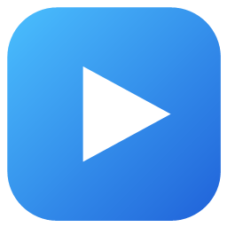

<div align="center">



# VidGood

**여러 영상을 한 창에서 나란히 — 가볍고 깔끔한 Windows 동영상 플레이어**

[](#-다운로드)
[](https://dotnet.microsoft.com/)
[](LICENSE)
[](https://www.videolan.org/vlc/libvlc.html)

[주요 기능](#-주요-기능) · [다른 플레이어와 비교](#-다른-플레이어와-비교) · [다운로드](#-다운로드) · [단축키](#%EF%B8%8F-단축키) · [직접 빌드](#%EF%B8%8F-직접-빌드)

</div>

---

## ✨ 주요 기능

<table>
<tr>
<td width="50%" valign="top">

### 🪟 자유로운 멀티뷰
- 한 창을 원하는 만큼 **분할**해서 여러 영상을 동시에 재생
- 경계선을 끌어 **비율 조절**, 좌우 ↔ 위아래 전환
- 화면 제목을 끌어 **다른 화면 옆에 붙이기 / 위치 교환**
- 창 밖으로 끌면 **새 창으로 분리**, 창끼리 화면 이동

</td>
<td width="50%" valign="top">

### 🎚️ 화면마다 따로
- 화면별 **배속**(0.25x ~ 2x), **90° 회전**, 볼륨, 재생 목록
- **소리 체크박스**로 원하는 화면만 소리 듣기
- “선택한 화면 따라 소리 자동 전환” 모드

</td>
</tr>
<tr>
<td valign="top">

### 📂 똑똑한 재생 목록
- 파일 하나만 열어도 **같은 폴더 영상이 자동으로** 목록에
- 영상을 연 **탐색기 창의 정렬 순서**를 그대로 따름
- 이름 / 수정한 날짜 / 만든 날짜 / 크기, 오름·내림차순 정렬
- 이전 · 다음 영상, 자동 다음 재생, 반복(전체/한 곡)

</td>
<td valign="top">

### ⚡ 편하게
- 설치 없이 **exe 하나**로 실행, 코덱 설치 불필요 (libVLC 내장)
- **보던 위치부터 이어보기**, 건너뛰기 간격 설정(3~30초)
- **모든 단축키 변경 가능**, 마우스 휠 볼륨, 더블클릭 전체 화면
- Windows 11 스타일 다크 UI, 항상 위에 표시

</td>
</tr>
</table>

## 📊 다른 플레이어와 비교

| | **VidGood** | Windows 미디어 플레이어 | VLC | PotPlayer | MPC-HC | mpv |
|:--|:--:|:--:|:--:|:--:|:--:|:--:|
| 한 창에서 여러 영상 분할 재생 | ✅ | ❌ | ❌ | ❌ | ❌ | ❌ |
| 드래그로 화면 배치 · 창 분리 | ✅ | ❌ | ❌ | ❌ | ❌ | ❌ |
| 화면별 소리 선택 | ✅ | ❌ | ❌ | ❌ | ❌ | ❌ |
| 탐색기 정렬 순서로 재생 목록 | ✅ | ❌ | ❌ | — | — | ❌ |
| 코덱 설치 없이 폭넓은 포맷 | ✅ | △¹ | ✅ | ✅ | ✅ | ✅ |
| 배속 재생 | ✅ | ✅ | ✅ | ✅ | ✅ | ✅ |
| 화면 회전 | ✅ | ❌ | ✅ | ✅ | ✅ | ✅ |
| 이어보기 | ✅ | ✅ | ✅ | ✅ | ✅ | △² |
| 단축키 변경 | ✅ | ❌ | ✅ | ✅ | ✅ | ✅ |
| 설치 없이 실행 | ✅ | 기본 내장 | △³ | ❌ | △³ | ✅ |
| 자막 꾸미기 · 싱크 조절 | ❌ | △ | ✅ | ✅ | ✅ | ✅ |
| 영상 필터 · 이퀄라이저 · 스크린샷 | ❌ | ❌ | ✅ | ✅ | ✅ | ✅ |
| 오픈소스 | ✅ MIT | ❌ | ✅ | ❌ | ✅ | ✅ |

<sub>¹ HEVC 등 일부 포맷은 Microsoft Store 확장 필요 · ² 설정으로 켜야 함 · ³ 별도 포터블 버전 · — 확인하지 못함<br/>
2026년 10월, 기본 설치 상태 기준입니다. 틀린 내용이 있으면 이슈로 알려주세요.</sub>

> **VidGood이 잘하는 것:** 강의 여러 개 비교, 경기 · 녹화본 나란히 보기처럼 **여러 영상을 동시에 보는 일**.
> 자막 편집이나 화질 필터 같은 고급 기능이 필요하면 PotPlayer · mpv 같은 플레이어가 더 맞습니다.

## 📥 다운로드

1. [Releases](https://github.com/alton15/vidgood/releases/latest)에서 `VidGood.exe`를 받습니다. (x64 Windows 10/11)
2. 실행하면 끝 — 설치 과정이 없습니다.

- 처음 실행할 때 재생 엔진을 한 번 준비합니다(진행 창이 뜨고 몇 초 걸려요). 다음부터는 바로 열립니다.
- 코드 서명이 없어서 처음에 SmartScreen 경고가 뜰 수 있습니다. **추가 정보 → 실행**을 누르세요.
- 영상 파일 연결: 영상 우클릭 → **연결 프로그램 → 다른 앱 선택** → exe 선택 → **항상**.

## ⌨️ 단축키

기본값이며, **설정 → 단축키**에서 모두 바꿀 수 있습니다.

| 재생 | | 화면 · 창 | |
|:--|:--|:--|:--|
| 재생 / 일시정지 | <kbd>Space</kbd> <kbd>K</kbd> | 화면 추가 | <kbd>Ctrl</kbd>+<kbd>T</kbd> |
| 뒤로 / 앞으로 건너뛰기 | <kbd>←</kbd> <kbd>→</kbd> | 새 창 | <kbd>Ctrl</kbd>+<kbd>N</kbd> |
| 이전 / 다음 영상 | <kbd>PageUp</kbd> <kbd>PageDown</kbd> | 선택한 화면 닫기 | <kbd>Ctrl</kbd>+<kbd>W</kbd> |
| 재생 속도 느리게 / 빠르게 | <kbd>[</kbd> <kbd>]</kbd> | 다음 화면 선택 | <kbd>Tab</kbd> |
| 재생 속도 1x | <kbd>Backspace</kbd> | 90° 회전 | <kbd>Ctrl</kbd>+<kbd>R</kbd> |
| 볼륨 | <kbd>↑</kbd> <kbd>↓</kbd> | 전체 화면 | <kbd>F11</kbd> <kbd>F</kbd> |
| 음소거 | <kbd>M</kbd> | 재생 목록 | <kbd>Ctrl</kbd>+<kbd>L</kbd> |
| 반복 모드 | <kbd>R</kbd> | 파일 / 폴더 열기 | <kbd>Ctrl</kbd>+<kbd>O</kbd> / <kbd>Ctrl</kbd>+<kbd>Shift</kbd>+<kbd>O</kbd> |

## 🛠️ 직접 빌드

필요한 것: [.NET 8 SDK](https://dotnet.microsoft.com/download/dotnet/8.0)

```powershell
git clone https://github.com/alton15/vidgood.git
cd vidgood
dotnet run                                              # 개발 실행
powershell -ExecutionPolicy Bypass -File publish.ps1    # 배포용 단일 exe → dist\
```

<details>
<summary><b>프로젝트 구조</b></summary>

| 파일 | 역할 |
| --- | --- |
| `App.xaml(.cs)` | VLC 엔진, 창 목록, 창 사이 화면 이동, 소리 라우팅, 공통 스타일 |
| `MainWindow.xaml(.cs)` | 툴바 + 분할 레이아웃을 가진 플레이어 창 (여러 개 열 수 있음) |
| `PaneLayout.cs` | 화면 분할 트리 (추가/제거/교환/방향 전환, 경계선 비율) → 각 화면 좌표 계산 |
| `PaneHost.cs` | 계산된 좌표에 화면·경계선을 배치. 배치를 바꿔도 화면을 떼었다 붙이지 않아 VLC 출력이 유지됨 |
| `PlayerPane.xaml(.cs)` | 화면 하나: 재생, 재생 목록·정렬, 배속, 회전, 소리, 드래그 이동 |
| `MediaLibrary.cs` | 재생 목록 구성과 정렬 (열린 탐색기 창의 정렬 순서 읽기 포함) |
| `Shortcuts.cs` | 단축키 정의(기본값)와 사용자 지정 키 |
| `AppSettings.cs` / `SettingsWindow.xaml(.cs)` | 설정 저장과 설정 창 (일반 / 단축키) |
| `VlcBootstrap.cs` / `SetupWindow.xaml(.cs)` | 배포 exe에 내장된 VLC를 첫 실행 때 풀기 |

</details>

<details>
<summary><b>배포 exe가 동작하는 방식</b></summary>

- `publish.ps1`은 .NET 런타임까지 포함한 self-contained 단일 exe를 만듭니다.
- libVLC(약 90MB)는 exe 안에 zip으로 들어 있고, 첫 실행 때 `%LOCALAPPDATA%\VideoPlayer\vlc\`에 한 번 풉니다. VLC 버전이 같으면 앱을 업데이트해도 다시 풀지 않습니다.
- 설정과 이어보기 위치: `%APPDATA%\VideoPlayer\settings.json`
- 재생 문제 진단: `$env:VP_VLC_LOG = "$env:TEMP\vlc.log"` 를 설정하고 실행하면 libVLC 로그가 남습니다.

</details>

## 🚧 알려진 한계

| 이럴 때 | 왜 그런가요 | 이렇게 해보세요 |
|:--|:--|:--|
| ⏩ 건너뛸 때 화면이 잠깐 멈춰요 | 정확한 위치를 찾느라 앞쪽 키프레임부터 다시 읽어요 | **설정 → 빠른 탐색**을 켜면 바로 이동해요 |
| 🔄 회전할 때 한 번 깜빡여요 | libVLC 3은 재생 중에 회전을 바꿀 수 없어서 같은 위치에서 다시 열어요 | 재생 위치와 일시정지 상태는 그대로 이어져요 |
| 🪟 파일을 열 때마다 새 창이 떠요 | 이미 켜진 VidGood으로 넘기는 기능이 아직 없어요 | 다음 버전에서 개선할 예정이에요 |

## 📄 라이선스

- VidGood 소스 코드: [MIT License](LICENSE) © 2026 [alton15](https://github.com/alton15)
- 재생 엔진 [libVLC](https://www.videolan.org/vlc/libvlc.html)와 [LibVLCSharp](https://github.com/videolan/libvlcsharp)는 **LGPL-2.1-or-later**입니다. 자세한 내용은 [THIRD-PARTY-NOTICES.md](THIRD-PARTY-NOTICES.md)를 참고하세요.
- VLC 및 VideoLAN은 VideoLAN의 상표이며, 이 프로젝트는 VideoLAN과 관련이 없습니다.
